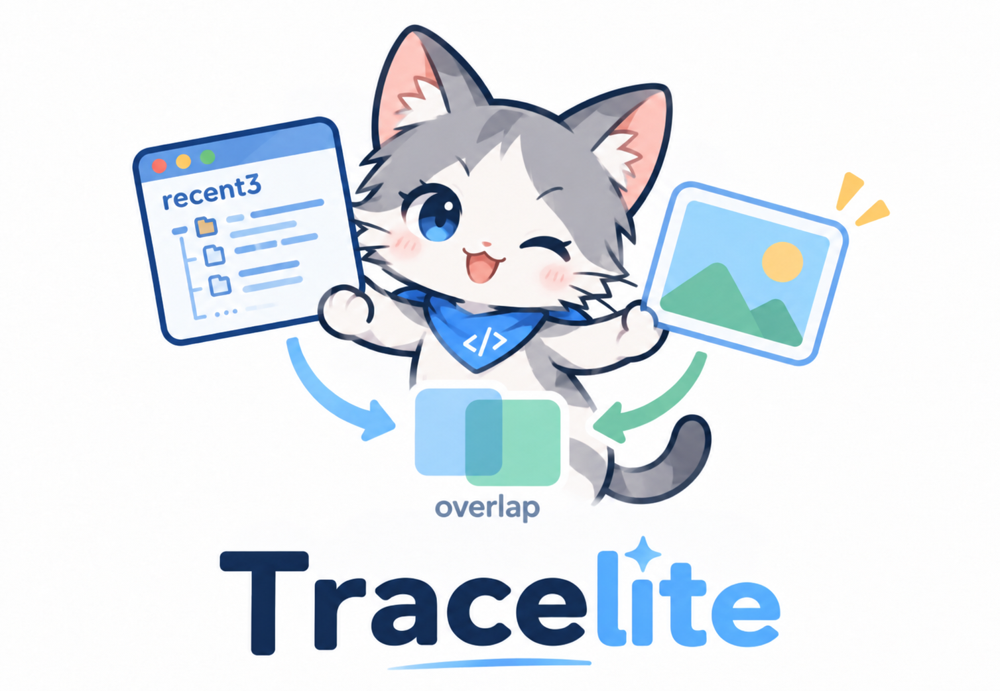
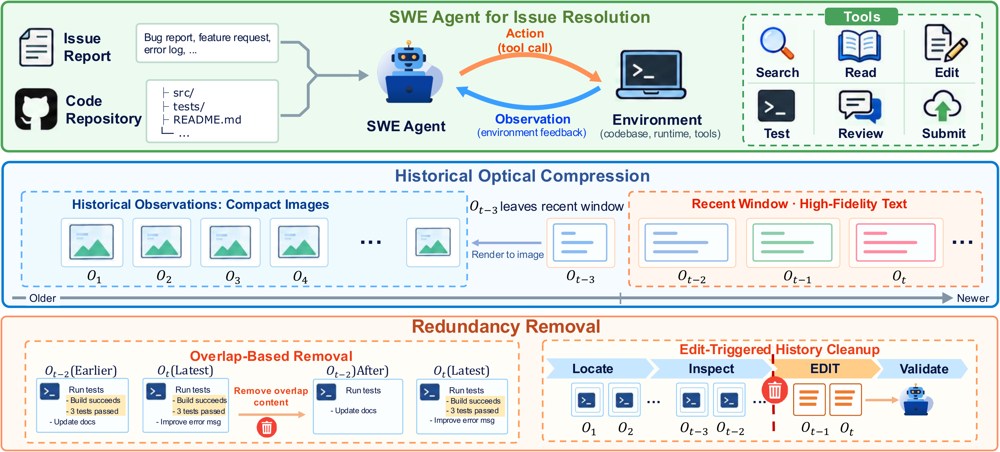
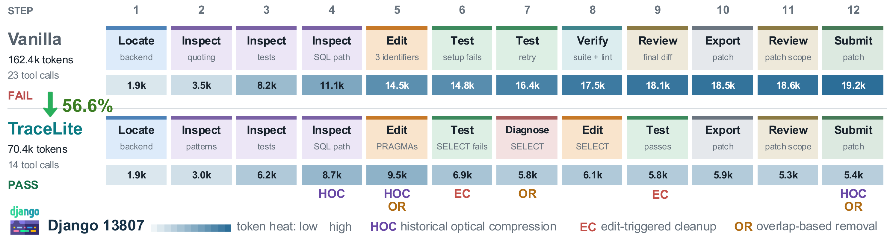

<h1 align="center">TraceLite: Efficient Trace Compression for SWE Agents</h1>

<p align="center">
  
  
  
  
  <a href="LICENSE"></a>
</p>

<p align="center">
  
</p>

<p align="center">
  <a href="#overview">Overview</a> ·
  <a href="#method">Method</a> ·
  <a href="#case-study">Case Study</a> ·
  <a href="#quick-start">Quick Start</a>
</p>

## Overview

TraceLite compresses software engineering agent trajectories through optical compression and redundancy filtering.

## Method

<p align="center">
  <a href="assets/figures/method-overview.png"></a>
</p>

1. **Preserve recent observations as text.** Keep exact paths, identifiers, and error messages in the recent window of three completed observation/action groups.
2. **Render older observations as images.** Compress observations as they leave the recent window, retaining tool calls as text.
3. **Remove recent overlap.** Remove shared content from earlier recent observations while preserving the latest evidence and non-overlapping content.
4. **Clear pre-edit history.** After a code edit, remove earlier observation payloads while retaining historical tool calls and the current edit's observation.

## Case Study

<p align="center">
  <a href="assets/figures/case-study-django-13807-paper.png"></a>
</p>

In Django issue **13807**, **HOC** compresses older observations, **OR** removes repeated content, and **EC** clears pre-edit observations after edits. TraceLite resolves the issue with **14 tool calls** and **70.4K input tokens**, versus Vanilla's unsuccessful **23 calls** and **162.4K tokens** (**56.6% fewer input tokens**).

## Quick Start

On Ubuntu/Debian with **Python 3.11+**:

```bash
sudo apt-get update
sudo apt-get install -y python3-venv fonts-dejavu-core fonts-noto-cjk
git clone https://github.com/xjywhu/TraceLite.git
cd TraceLite
python3 -m venv Tracelite/.venv
Tracelite/.venv/bin/python -m pip install -e ./Tracelite
Tracelite/.venv/bin/tracelite-render /path/to/task.traj.json \
  --output-dir artifacts/history
```

The renderer defaults to a 4× image budget and keeps the latest three observation/action groups as text.
